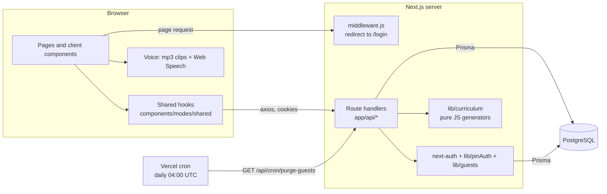
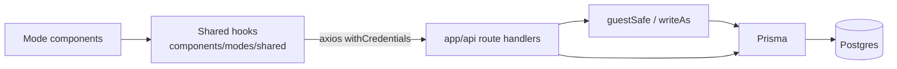

# Architecture

Braylee's Space Academy is a Next.js (App Router) web app where a child practices times tables, grade 1-6 math missions and spelling. This page explains how the pieces fit. Reference detail lives in [API.md](API.md) and [DATA-MODEL.md](DATA-MODEL.md).

The npm package name is `braylee-times-table-next`.

## Stack

| Layer | Choice |
|---|---|
| Framework | Next.js 14 (App Router), React 18, plain JS/JSX (only `config/gifs.ts` is TypeScript) |
| Auth | next-auth v4, JWT sessions, `@auth/prisma-adapter` |
| Database | PostgreSQL via Prisma 5.15 |
| Styling | Tailwind CSS 3 (dark theme only), framer-motion, three.js scene (`components/space`) |
| Tests | vitest (`npm test`); the two Postgres-backed tests (`tests/guestWrite.pg.test.js`, `tests/savedCadets.pg.test.js`) are skipped without `TEST_DATABASE_URL` |
| Hosting | Vercel (production, daily cron) or Docker (`docker-compose.yml`: Postgres on host port 55436, app on 3200) |

## System overview



Problems for skill missions are generated in the browser from `lib/curriculum`; the server only judges the answer and stores progress. Voice is entirely client side.

## App Router layout

| Path | Kind | Purpose |
|---|---|---|
| `app/layout.jsx` | server | Root layout, fonts, metadata, footer credit, wraps children in `Providers` |
| `app/providers.jsx` | client | `SessionProvider`, reduced-motion config, `SpaceBackground`, `GifProvider` |
| `app/page.jsx` | client | `/`: the signed-in home shell (menu, Mission Map, mode screens, grade gate, cadet welcome) |
| `app/login/` | client | `/login`: guest buttons and the "Are you a saved cadet? Sign in" name + student ID form (`_components/useLogin.js`) |
| `app/spelling-bee/page.jsx` | client | `/spelling-bee` renders `SpellingBeeMode` |
| `app/skill/[id]/page.jsx` | client | `/skill/<skillId>` renders `SkillMode` for a generated-problem mission |
| `app/gifs/page.jsx` | server | Dev-only GIF review grid; calls `notFound()` in production |
| `app/api/**/route.js` | server | Route handlers, see [API.md](API.md) |
| `middleware.js` | edge | Redirects signed-out visitors from `/`, `/spelling-bee`, `/skill/*` to `/login` |
| `components/` | client | Mode shells (`PracticeMode`, `TestingMode`, `MemorizeMode`, `SkillMode`, `SpellingBeeMode`), `MissionMap`, `game/`, `ui/`, `space/`, `gif/`, `braylee/` |
| `lib/` | shared | Server logic (`pinAuth`, `guests`, `savedCadets`, `savedCadetPurge`, `cadetNames`, `guestWrite`, `rateLimit`, `skillState`, `mathSkills`) and client helpers (`voice`, `cheerVoice`, `gameFx`, `momentDirector`) |

`middleware.js` only checks that a JWT with an `id` exists (`getToken` with `NEXTAUTH_SECRET`). It does not check that a guest seat is still valid. API routes do their own auth, and the client falls back to `useLoginRedirect` when next-auth reports `unauthenticated`.

## Identity model

There is one pre-existing real account, Braylee. Everyone else plays as an anonymous guest seat, and a guest may convert their seat into a **saved cadet** (a nickname plus a student ID, progress kept). There are no sign-ups (`/api/auth/register` returns 404); the only way to get a named account is saving a guest.

```mermaid
sequenceDiagram
  participant B as Browser (/login)
  participant S as Server
  participant D as DB
  Note over B,D: Guest path
  B->>S: POST /api/guest/claim {mode: new or resume}
  S->>D: pick or reuse a seat, store sha256(secret)
  S-->>B: Set-Cookie guest_seat (httpOnly, 7 days)
  B->>S: signIn('guest') (next-auth)
  S->>D: find seat by cookie hash, touch lastActiveAt
  S-->>B: session JWT {id, gk = seat hash}
  B->>S: GET /api/auth/me (polled until 200)
  Note over B,D: Braylee path
  B->>S: signIn('credentials', name + student ID, exactly 6 digits)
  S->>D: claim a login attempt, bcrypt compare against the peppered hash
  S-->>B: session JWT {id, sc = true for a saved cadet}
  B->>S: POST /api/auth/link-cookie (confirms session)
  Note over B,D: Save my cadet (guest only)
  B->>S: POST /api/cadets/save {name, secret, confirm}
  S->>D: one transaction: seat row becomes the named account
  S-->>B: {ok, name}; guest cookie cleared
  B->>S: signIn('credentials', new name + student ID)
```

### Student ID sign-in (Braylee and saved cadets)

- next-auth Credentials provider (`lib/auth.js`) calls `verifyPin` (`lib/pinAuth.js`) with a name and a student ID of exactly 6 digits (`lib/cadetNames.js` holds the one definition). The login page asks for both: Braylee types her name too. The match on the name is exact first, then case-insensitive when unambiguous. Four-digit PINs are not accepted.
- The ID lives in `User.pin` as `bcrypt(HMAC-SHA256(pepper, id))` (10 rounds). The pepper is derived from `NEXTAUTH_SECRET` with HKDF, so a stolen database alone cannot be brute forced, and rotating `NEXTAUTH_SECRET` invalidates every student ID. Verification tries the peppered hash, then plain bcrypt, then a legacy plaintext value. A row in an older format is rewritten as peppered on a successful sign-in, but only when `VERCEL_ENV=production` (or `PIN_REHASH=1`), so a preview or laptop pointed at the prod DB with another secret cannot rewrite Braylee's hash.
- The seed (`prisma/seed-users.js`) takes the initial value from `SEED_BRAYLEE_PIN` (exactly 6 digits). If it is unset, a random one is generated and printed once, only when the user row is created. The seed never overwrites an existing user. Nothing is stored in source. To set or reset a named account's ID use `npm run db:set-student-id` (see [OPERATIONS.md](OPERATIONS.md)).
- **Uniform failures.** An unknown name, a guest seat name, a wrong ID and a resting account all give the same HTTP 401 and message ("That didn't work. Check your name and student ID, or try again in a little while.") with the same bcrypt work, so the form cannot be used to find out which nicknames exist. Only the per-IP limit answers 429.
- The ID is never logged, returned or stored in plaintext. The input is a masked text field (not `type="password"`) so password managers do not offer to save it on a shared device.

### Saved cadets

Implemented in `lib/savedCadets.js` (save), `lib/savedCadetPurge.js` (retention, session check) and `lib/cadetNames.js` (validation). A guest who taps "Save my cadet" in the home menu calls `POST /api/cadets/save`. In one transaction behind a Postgres advisory lock the guest seat row itself becomes the account: `name` is the nickname, `pin` the hashed student ID, `isGuest = false`, `guestSeat` and `guestTokenHash` cleared, `savedCadet = true`, `savedAt` set. The row id is unchanged, so all progress stays. A fresh empty guest seat is created in its place. The update is a compare-and-set on the seat's token hash, so an in-flight guest write either finishes first or is rejected.

| Rule | Value |
|---|---|
| Cap | `SAVED_CADETS_MAX` (default 10, clamped 0-500); Braylee is not counted. Beyond it: 409 `full`, the kid keeps playing as a guest |
| Nickname | 2-16 characters (letters, numbers, space, `'`, `-`), unique case-insensitively, reserved names (Braylee, Bray, Guest, Cadet) and profanity refused |
| Retention | Deleted with all their data after `SAVED_CADET_RETENTION_DAYS` (default 30, clamped 1-3650) without activity (`lastActiveAt`). Runs lazily (sign-in, saves, every few minutes on saved-cadet requests) and in the daily cron. Braylee is never purged |
| Progress rows | Conversion is in place, so every progress row (including `SkillUnlock`) keeps its `userId` and follows the cadet. The purge deletes `SEAT_TABLES` (which includes `skillUnlock`) plus `account` and `session`; the refilled guest seat is a new row with no unlocks |
| Session | The JWT carries `sc`. `getActor()` re-checks the row is still a saved cadet and refreshes `lastActiveAt` (throttled), so a purged cadet is signed out |
| Isolation | Every API route is scoped to the caller's own id; a saved cadet reads and writes only their own data |

### Lockout tiers

Each attempt first claims a slot with one conditional `UPDATE` on the `User` row (increment `failedLoginAttempts`, set `lockedUntil` in the same statement, only if not currently locked). Parallel requests therefore cannot all test an ID before the first lock is written. A correct ID resets the counter and the lock. A resting account is told nothing different from a wrong ID (see uniform failures above).

| Consecutive wrong IDs | Rest |
|---|---|
| 1-4 | none |
| 5-9 | 1 minute |
| 10-14 | 5 minutes |
| 15-19 | 30 minutes |
| 20-24 | 2 hours |
| 25 or more | 24 hours (re-applied on every further wrong ID) |

Trade-off: because the lock is per account, anyone who knows the name can keep that account resting. This is accepted for a small child app; the ID space (10^5 to 10^8) is small, so the pepper and the lock are the main defence. See [Rate limiting](#rate-limiting-and-its-serverless-limits) for the per-IP limit.

### Guest seats

Implemented in `lib/guests.js`. Seats are `User` rows named `Guest 001`, `Guest 002`, ... with `isGuest = true`, created lazily by the first guest claim (`ensureSeats`).

| Rule | Value |
|---|---|
| Seat count | `GUEST_SEATS`, default 5, clamped to 1-100 |
| Proof of ownership | Random 32-byte secret in the `guest_seat` cookie (httpOnly, `sameSite=lax`, `secure` in production, path `/`, 7 days). Only its sha256 is stored in `User.guestTokenHash`. A null hash means the seat is free |
| Idle wipe | A claimed seat with no activity for 7 days is wiped (attempts, progress, grade, level back to 1) and freed |
| Takeover | A new device may take a seat that is not free only if it has been idle for at least `GUEST_MIN_IDLE_MINUTES` (default 15, max 7 days). Otherwise the claim returns 503 `busy` |
| Display name | "Cadet 003" in the UI (`seatLabel`); the stored name is `Guest 003` |

**Claim.** `POST /api/guest/claim` with `mode: "new"` first releases any seat this device already holds (so a device never holds two), then takes a free seat, or the longest-idle eligible one, using compare-and-set updates. `mode: "resume"` keeps the device's seat (409 if it has none).

**Resume.** `GET /api/guest/status` tells the login page whether this device still owns a seat, so it can offer "Continue as Cadet NNN".

**Sliding cookie.** The 7-day cookie is renewed when the seat is used: on `resume`, and on every `GET /api/auth/me` for a guest whose cookie hash matches the seat. A kid who plays regularly keeps the seat; signing out and back in does not lose it.

**Session binding.** The guest JWT carries `gk`, the seat's token hash. On every API call `getActor()` (`app/api/_utils.js`) re-checks that the seat still has that hash. If the seat was wiped, rotated or reassigned, the caller is treated as signed out (401).

**Safe writes.** Every write for a signed-in user goes through `guestSafe` / `writeAs` (`lib/guestWrite.js`): a transaction that, for guests, first runs `SELECT 1 FROM "User" WHERE id AND "guestTokenHash" = gk FOR SHARE`. A wipe updates the same row first, so the two conflict: either the wipe waits and then deletes what the write added, or the write sees the rotated token and answers 401. A write can never land after a wipe and leave rows for the next player.

**Idle purge.** `purgeExpired` runs lazily (before claims, status checks, token lookups and guest session validation) and daily from the cron. The lazy call is best effort: a failing purge is logged and never breaks the request (`purgeExpiredQuietly`).

**Cron.** `vercel.json` schedules `GET /api/cron/purge-guests` at `0 4 * * *` (UTC). The route requires `Authorization: Bearer $CRON_SECRET` (timing-safe compare) and refuses everyone if `CRON_SECRET` is unset.

### Rate limiting and its serverless limits

`lib/rateLimit.js` is an in-memory fixed-window counter, capped at 5,000 keys (expired keys are pruned; if still full the oldest key is evicted).

| Limit | Where | Value |
|---|---|---|
| Login per IP | `verifyPin` | 30 requests per 10 minutes |
| New guest claim per IP | `POST /api/guest/claim` (`mode: new` only) | 10 per 10 minutes |
| Save a cadet per IP | `POST /api/cadets/save` | 10 per 10 minutes |

Limits to know about:

- The counter lives in one server instance. Serverless instances do not share it, so it slows a script hammering one instance and nothing more. It is not a global guarantee.
- The client IP is the first entry of `x-forwarded-for` (or `x-real-ip`). That is trustworthy behind Vercel's proxy; where a client can set the header itself (for example the Docker setup without a trusted proxy) it can be spoofed.
- A flood of distinct keys can evict real counters (bounded memory is the trade-off).
- Because of the above, the real protections are in the database: the per-account lockout and the seat compare-and-set logic. Known consequence: someone can repeatedly claim "new" seats from different instances and rotate idle seats once they pass the minimum idle time, wiping the previous player.

## Client data flow



Hooks in `components/modes/shared/`:

| Hook | Role |
|---|---|
| `useAuthUser` | `GET /api/auth/me` through `confirmSession` (6 tries with growing delay). Only a definite 401/403/404 clears the session (`authLogic.shouldSignOut`); a network error or 5xx shows a retry panel instead of signing out |
| `useHomeData` | Loads `/api/problems`, `/api/attempts/last5`, `/api/progress/summary`, `/api/curriculum/me`. Keyed on the user id, so a new user object with the same id does not refetch. A failed missions request sets `error: true` instead of looking like "no grade set" |
| `useLevelUp` | `POST /api/users/level` after a level-1 test pass |
| `useSkillLoader` / `useSkillGame` | Load a skill from `/api/curriculum/me?grade=all`, generate problems locally, `POST /api/math/attempt` per answer |
| `useSpellingWords` / `useSpellingRound` | Fetch `/api/spelling/words`; a round runs entirely in the browser |

Drill modes (`components/modes/drill/`) post each answer to `/api/problems/[id]/attempt` in the background and never block the UI on it. Nothing is cached in the browser beyond React state; the home screen refetches when the player returns to it.

Browser storage (all access wrapped in try/catch): `localStorage` keys `braylee-voice-muted`, `braylee-voice-settings`, `braylee.bestStreak.<mode>`, `host-welcomed`; `sessionStorage` key `cadetWelcome` (one-shot hand-off from `/login`). These are per device, not per account.

Spelling Bee results are not saved: nothing writes `SpellingAttempt`.

## Curriculum engine

Pure JavaScript in `lib/curriculum/math` (no UI, DB or network): 79 skills and 254 levels for grades 1-6, generated from `docs/curriculum/math.json` (copied to `lib/curriculum/math/spec.json`). It generates problems (`generateProblem`), judges answers (`checkAnswer`) and evaluates mastery (`masteryStatus`). Full API in [lib/curriculum/README.md](../lib/curriculum/README.md).

App glue:

- `lib/mathSkills.js`: flattens the spec; `LEVEL_ADVANCE_WINDOW = 10` (last 10 answers at a non-final level decide the level-up) and `WINDOW_DEFAULT = 20` (final level: last 20 decide mastery). A correct answer counts only if it is also within the skill's `secondsPerProblem` using the measured `ms`.
- `lib/skillState.js`: builds per-user state for `GET /api/curriculum/me`. A skill unlocks if it is first in its grade, already mastered, already attempted, the previous skill in the same grade is mastered, or it was unlocked before. Unlocks are stored in `SkillUnlock` (one extra read per request; new ones are written with an idempotent `createMany`, through `writeAs` so a wiped guest seat cannot receive them) and are permanent until the player's progress is wiped.
- Six times-table skills (`lib/problemSkills.js`) are backed by the 144 `Problem` rows (`UserProblem` / `Attempt`) instead of generators; `POST /api/math/attempt` rejects them with 400. A fact is mastered after 3 correct answers in a row (`lib/mastery.js`); any miss clears it.
- Spelling content: authored in `docs/curriculum/spelling.json`, imported into `SpellingWord` by `npm run db:import-spelling`. The API falls back to the bundled `lib/spellingWords.json` (54 words) if the table is empty or unreachable.

The player-facing rules (Mission Map, Practice, Testing, Spelling Bee) are in [GAMEPLAY.md](GAMEPLAY.md).

## Voice and cheers

Entirely client side, no paid API calls at runtime:

1. Text lines per moment in `config/brayleeLines.js`.
2. Pre-recorded mp3 clips in `public/audio/braylee/`, mapped by `config/brayleeClips.mjs`. The clips are Braylee's cloned voice for cheers only, generated outside the repo. A test fails if lines and clips drift apart.
3. Browser speech (`lib/voice.js`, Web Speech API) for everything without a clip (names, large streak counts, spelling words and teacher instructions).
4. `lib/cheerVoice.js` orchestrates: throttling, no overlap, spelling words always win, a missing or blocked clip falls back to speech, then to silence.
5. `lib/momentDirector.js` makes sure only one big moment (modal, streak card, celebration card, astronaut bubble) shows at a time; higher priority preempts lower, which is dropped rather than queued.

See [GAMEPLAY.md](GAMEPLAY.md) for what plays when.

## Security headers

`next.config.js` `headers()` sends on every route (`source: '/(.*)'`), covered by `tests/securityHeaders.test.js`:

| Header | Value |
|---|---|
| `X-Frame-Options` | `DENY` |
| `Content-Security-Policy` | `frame-ancestors 'none'` |
| `X-Content-Type-Options` | `nosniff` |
| `Referrer-Policy` | `strict-origin-when-cross-origin` |

There is no full CSP (script/style/img sources) yet. Celebration GIFs load from a third-party host (`config/gifs.ts`), so a strict `img-src` would need that host added.

## Database errors during deploys

`lib/dbErrors.js` recognises "the code is ahead of the database" (missing tables or columns added by the newer migrations, Prisma codes P2021, P2022, P2010). Routes that opt in answer `503 { maintenance: true }` with `Retry-After: 120` and a friendly message instead of a 500. Add new columns and tables to the lists in that file when a migration adds something the code depends on. See [DATA-MODEL.md](DATA-MODEL.md#rules-for-adding-migrations).

## Key design decisions and trade-offs

| Decision | Why | Cost |
|---|---|---|
| One real account plus guest seats and optional saved cadets, no sign-ups | A child's app should hold almost no personal data; guests store only a seat number, saved cadets only a nickname and a hashed student ID | Guest data disappears after 7 idle days, saved cadets after 30; a shared pool of seats can run out; saved cadets are capped |
| Guest secret in an httpOnly cookie, only its hash in the DB | A DB leak does not hand out seats; JavaScript cannot read the cookie | No cross-device resume |
| `FOR SHARE` lock check on every guest write | Closes the race between a seat wipe and an in-flight write | Writes run in a transaction (15 s timeout) |
| Lockout stored in the DB, claimed with one atomic UPDATE | Works across serverless instances; no parallel ID guessing; failures look identical | Account-level lock can be triggered by anyone who knows the name |
| In-memory per-IP limits | No extra infrastructure | Best effort only (see above) |
| Student ID hashed with a pepper derived from `NEXTAUTH_SECRET` | A DB leak alone cannot be brute forced | Rotating the secret invalidates every student ID |
| JWT sessions, no session table use | Cheap on serverless | The JWT cannot be revoked server side; guest sessions rely on the `gk` re-check and saved cadets on the `sc` row check, Braylee's does not |
| Problems generated in the browser, server judges and records | Fast, no per-question round trip | The server trusts the client's `expected` string for generated skills; a user can only affect their own progress |
| Times tables stay in `Problem` rows | Original data model, shared counters | Two progress models (Problem rows vs `MathSkillProgress`) |
| Additive-only migrations | Old code keeps working while the DB is migrated first | Unused columns stay (see [DATA-MODEL.md](DATA-MODEL.md#legacy-and-unused-columns)) |
| Migrations do not run on Vercel deploy | Prevents a deploy from altering prod unseen | Someone must run them by hand before merging; the app shows the maintenance response if they were missed |
| Voice clips are static files; speech is the fallback | Free, offline-friendly, no API cost | Clip set must be kept in sync with lines by hand |

## Related docs

- [API.md](API.md) - every route handler
- [DATA-MODEL.md](DATA-MODEL.md) - tables, relations, migrations
- [DEPLOY-RUNBOOK.md](DEPLOY-RUNBOOK.md) - production migration and deploy steps
- [lib/curriculum/README.md](../lib/curriculum/README.md) - problem generator library
