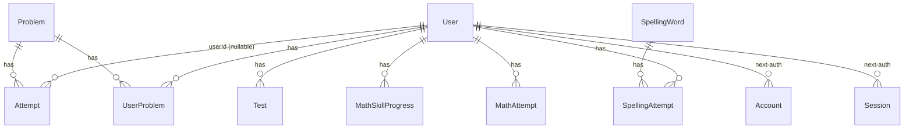

# Data model

PostgreSQL through Prisma 5.15. The schema is `prisma/schema.prisma`; migrations are in `prisma/migrations/`. For how the data is used see [ARCHITECTURE.md](ARCHITECTURE.md); for the routes that touch it see [API.md](API.md).

## Entity relationships

`VerificationToken` has no relations. Math skills are not a table: `skillId` is a string that points into `lib/curriculum/math/spec.json`.

## Models

### Players

| Model | Purpose | Fields that matter |
|---|---|---|
| `User` | Braylee's real account, the guest seats and saved cadets | `name` (unique; `Braylee`, a saved cadet's nickname, or `Guest 001`...), `pin` (bcrypt hash of the student ID, HMAC-peppered; null for guests; the column name is historical), `image` (public path), `level` (times-table level 1 or 2), `grade` (1-6 or null), `failedLoginAttempts` / `lockedUntil` (student-ID lockout, tiers up to 24 h), `isGuest`, `guestSeat` (unique), `guestTokenHash` (unique sha256 of the cookie secret; null = free seat), `lastActiveAt` (drives the 7-day guest idle wipe and the saved-cadet retention), `savedCadet` (true for a saved cadet, default false), `savedAt` (when the guest was saved, nullable) |

Deleting a user cascades to `UserProblem`, `SpellingAttempt`, `MathSkillProgress`, `MathAttempt`, `Account` and `Session`. `Attempt` and `Test` do not cascade (the database sets `Attempt.userId` to null on user delete, and `Test` rows block the delete); the guest wipe (`wipeSeat` in `lib/guests.js`) deletes rows from `attempt`, `test`, `spellingAttempt`, `mathAttempt`, `mathSkillProgress` and `userProblem` explicitly, in one transaction with the seat reset. A saved cadet is deleted by `purgeInactiveSaved` (`lib/savedCadetPurge.js`) the same way (same `SEAT_TABLES`, plus `account` and `session`, then the user row) after `SAVED_CADET_RETENTION_DAYS` idle days; Braylee is excluded.

A saved cadet is a guest seat row converted in place (`isGuest` false, `guestSeat` and `guestTokenHash` null, `savedCadet` true), so `id` and all progress stay. Names are unique case-sensitively in the database; the save transaction also checks case-insensitively.

### Times tables

| Model | Purpose | Fields that matter |
|---|---|---|
| `Problem` | The 144 facts (1-12 x 1-12), shared by all players. Seeded by `prisma/seed.js` or lazily by `GET /api/problems` | `problem` (text such as `7 x 8`), `answer`, `correct` / `incorrect` (global counters across all players) |
| `Attempt` | A player's recent answers to one fact. Only the newest 5 per user and problem are kept | `problemId`, `userId` (nullable), `isCorrect`, `createdAt` |
| `UserProblem` | Per-player summary of one fact. Primary key `(userId, problemId)` | `everCorrect` (ever answered right; used to unlock Testing and Level 2), `mastered` (last 3 attempts all correct; any miss clears it, see `lib/mastery.js`) |
| `Test` | A saved Testing-mode score | `score`, `userId`. Written only by `POST /api/test/score`, which the UI does not call |

### Generated math

| Model | Purpose | Fields that matter |
|---|---|---|
| `MathSkillProgress` | One row per player and skill. Unique `(userId, skillId)` | `levelIndex` (0-based into the skill's levels), `recent` (JSON array `[{ c: boolean, ms: number }]`, oldest first, capped at the skill's window, 20 by default; cleared when the level advances), `attempts`, `correct`, `mastered`, `masteredAt` |
| `MathAttempt` | Append-only log of every generated-problem answer | `skillId`, `levelIndex`, `prompt`, `expected`, `given`, `correct`, `ms` |

The six times-table skills (`g3-mult-0-1-2-5-10`, `g3-mult-3-4`, `g3-mult-9-squares`, `g3-mult-6-7-8`, `g3-mult-mixed`, `g4-mult-11-15`) use the `Problem` / `UserProblem` tables instead and have no rows here.

### Spelling

| Model | Purpose | Fields that matter |
|---|---|---|
| `SpellingWord` | Word bank. Filled by `npm run db:import-spelling` (idempotent; fills only empty fields on the 54 original rows) | `word` (unique), `definition`, `partOfSpeech`, `sentence`, `difficulty`, `active`, `grade`, `unitId`, `tier` (`core`, `hf`, `bee`), `syllables`, `source` (`original` or `legacy`) |
| `SpellingAttempt` | Intended per-word history | `userId`, `wordId`, `isCorrect`. Nothing writes to it today |

### next-auth

| Model | Status |
|---|---|
| `Account`, `Session`, `VerificationToken` | Required by `PrismaAdapter`. Sessions use JWT and sign-in is credentials only, so these tables stay empty in practice |
| `User.email`, `User.emailVerified` | Same: adapter fields, unused |

## Legacy and unused columns

The project is additive-only, so these remain in the schema.

| Column or table | Status |
|---|---|
| `User.isAdmin` | Unused since the parent screens were removed |
| `MathSkillProgress.unlockedByParent` | Was set from the removed parent screen; no longer read or written |
| `Problem.mastered` | Never written by current code; per-player mastery lives in `UserProblem.mastered` |
| `Test` table | Only written by an unused route |
| `SpellingAttempt` table | Never written |
| `Account`, `Session`, `VerificationToken`, `User.email`, `User.emailVerified` | Adapter requirements, unused |
| `User.pin` plaintext values | Legacy rows may still hold a plaintext value, or a plain (un-peppered) bcrypt hash, until their next successful sign-in in production, which re-hashes it with the pepper |
| `Attempt.userId` nullable | Allows rows without an owner; current code always sets it |

## Migration history

Migrations live in `prisma/migrations/<timestamp>_<name>/migration.sql`.

| Migration | Adds |
|---|---|
| `20250817_init` | `Problem`, `Attempt`, `UserProblem`, `User`, `Test`. Never edit it (production has recorded its checksum) |
| `20260301000000_baseline_prod_schema` | Catch-up to production's schema: `User.email`, `emailVerified`, `failedLoginAttempts`, `isAdmin`, `lockedUntil`, `UserProblem.mastered`, plus `Account`, `Session`, `VerificationToken`, `SpellingWord`, `SpellingAttempt`. On production it must be marked as applied, not run (see the runbook) |
| `20260401000000_add_grade_and_math_progress` | `User.grade`, `SpellingWord.grade`/`unitId`/`tier`/`syllables`/`source` and indexes, tables `MathSkillProgress` and `MathAttempt` |
| `20260501000000_add_math_unlocked_by_parent` | `MathSkillProgress.unlockedByParent` |
| `20260601000000_add_guest_seats` | `User.isGuest`, `guestSeat` (unique), `guestTokenHash` (unique), `lastActiveAt` |
| `20260701000000_add_saved_cadets` | `User.savedCadet BOOLEAN NOT NULL DEFAULT false`, `User.savedAt TIMESTAMP(3)` (nullable) |

Production's migration table also lists two earlier migrations whose source files are not in the repo (`20260129173431_add_login_security`, `20260129174704_add_user_mastery`). Prisma reports them as "not found locally" and carries on. Full adoption steps for production are in [DEPLOY-RUNBOOK.md](DEPLOY-RUNBOOK.md); that document was written for the original adoption, so confirm the current production state with JC before following it.

## Applying migrations

| Where | How |
|---|---|
| Fresh local or Docker database | `npm run db:migrate` (`prisma migrate deploy`). The Docker entrypoint runs `prisma migrate deploy` and `prisma db seed` on every start |
| New migration while developing | `npm run prisma:migrate` (`prisma migrate dev`) against a local database only, then commit the generated folder |
| Seeding | `npm run db:seed`. `prisma/seed.js` seeds the 144 problems if none exist, then calls `prisma/seed-users.js`, which creates Braylee only if missing and reads the student ID from `SEED_BRAYLEE_PIN`, 5-8 digits (see [ARCHITECTURE.md](ARCHITECTURE.md#student-id-sign-in-braylee-and-saved-cadets)) |
| Production | Never automatic. Migrations do not run on deploy. Run them by hand, before merging the code that needs them |

## Rules for adding migrations

1. **Additive only.** Add nullable or defaulted columns and new tables. Do not drop, rename or tighten existing columns in the same release as the code that stops using them. The old code must keep working on the migrated schema, because the database is migrated before the new code is deployed.
2. **Never edit a migration that has been applied anywhere**, especially `20250817_init` and the baseline.
3. **Name and order.** Use a `YYYYMMDDHHMMSS_description` folder name that sorts after every existing one.
4. **No schema changes by hand in production.** Generate SQL with Prisma and review it before it runs.
5. **Back up first.** Take a database backup before migrating production.
6. **Tell the maintenance guard.** If the new code depends on a new table or column, add it to `NEW_TABLES`, `NEW_QUALIFIED_COLUMNS` or `DISTINCT_COLUMNS` in `lib/dbErrors.js`, so a deploy that gets ahead of the database shows the friendly 503 maintenance response instead of a 500.
7. **Guest wipes.** If the new table holds per-player data, add its model to the `SEAT_TABLES` list in `lib/guests.js` so a wiped guest seat leaves nothing behind. Give it `onDelete: Cascade` on `userId` where possible.
8. **Tests.** Update or add tests next to the existing ones in `tests/` (route tests use `tests/api/helpers.js`).
9. **Docs.** Update this file and the model comments in `prisma/schema.prisma`.

## Related scripts

| Script | Purpose |
|---|---|
| `npm run db:set-student-id` (`scripts/set-student-id.js`) | Sets or resets a named (non-guest) account's student ID: `-- --name Braylee`. Reads the ID from a hidden prompt or stdin, never argv; stores a plain bcrypt hash in `User.pin` and clears the lockout columns; prints only the number of rows updated. `--i-have-a-backup` is required for a non-localhost `DATABASE_URL` |
| `npm run db:import-spelling` (`scripts/import-spelling.js`, `--dry-run` supported) | Load `docs/curriculum/spelling.json` into `SpellingWord` |
| `npm run db:cleanup-accounts` (`scripts/cleanup-accounts.js`) | One-time cleanup for the "one real account plus guest seats" model: keeps `Braylee`, merges a few exact-name duplicates, deletes other non-guest users. Refuses to run, even as a dry run, while any saved cadet exists unless `--include-saved-cadets` is passed (then they are deleted too). Dry run by default (does everything, then rolls back); `--confirm` writes in one transaction, and `--i-have-a-backup` is required for a non-localhost `DATABASE_URL`. Destructive; read the file header and take a backup before running it against any real database |
