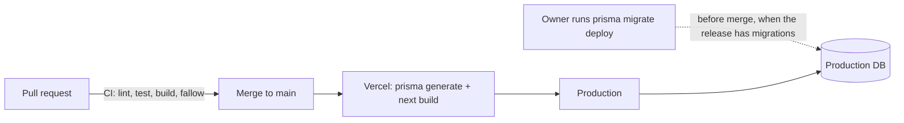

# Operations

How the app is deployed, configured, released and looked after. Written for the owner returning after a break and for a new contributor. No secrets, student IDs or connection strings belong in this file; names of variables only.

Related: [TESTING.md](TESTING.md), [KNOWN-ISSUES.md](KNOWN-ISSUES.md), [DEPLOY-RUNBOOK.md](DEPLOY-RUNBOOK.md) (one-time November 2026 adoption runbook).

## Environments

| Environment | Where | Database | Notes |
|---|---|---|---|
| Production | Vercel, built from `main` | Hosted Postgres, connection string in the Vercel production environment | The only deployed environment. |
| Local dev | `npm run dev:local` on `http://localhost:3300` | docker compose `db` service on `localhost:55436` | Loads `.env.docker`, rewrites the DB host to localhost. |
| Local prod-build stack | `docker compose up -d --build`, app on `http://localhost:3200` | same compose `db` service | Runs the production Docker image. See [Docker compose stack](#docker-compose-stack). |

## How deploys work

`vercel.json` controls what Vercel builds:

```json
{
  "crons": [{ "path": "/api/cron/purge-guests", "schedule": "0 4 * * *" }],
  "git": { "deploymentEnabled": { "ui-overhaul": false } },
  "ignoreCommand": "[ -n \"$VERCEL_GIT_COMMIT_REF\" ] && [ \"$VERCEL_GIT_COMMIT_REF\" != \"main\" ]"
}
```

- `ignoreCommand` exits 0 (skip the build) when there is a git branch name and it is not `main`. So only pushes to `main` build. A build with no git ref (a CLI deploy) or an empty ref is not skipped. `tests/vercelConfig.test.js` checks exactly this.
- The `git.deploymentEnabled` entry for `ui-overhaul` is a leftover from an old branch. It is harmless (that branch is gone and `ignoreCommand` already skips every non-main branch) and can be deleted.
- The build command is `npm run build`, which is `prisma generate && next build`. The build does **not** run migrations and does not connect to the database. `npm install` also runs `prisma generate` through `postinstall`.
- Merging to `main` therefore deploys code only. Database migrations are applied by hand by the owner, before the merge (see the release checklist).



## Environment variables

Set in the host (Vercel project settings, or `.env.docker` locally). `env.example` lists the same keys. Never commit values.

| Variable | Required | Used by | Meaning |
|---|---|---|---|
| `DATABASE_URL` | yes | Prisma (`schema.prisma`), all DB code | Postgres connection string. |
| `NEXTAUTH_SECRET` | yes | next-auth (reads it from the environment), `middleware.js`, `lib/pinAuth.js` | Signs and reads the session JWT. Without it logins do not work. It also derives the pepper for student-ID hashes (HKDF), so **rotating it signs everyone out and invalidates every student ID** (Braylee's must be reset with `npm run db:set-student-id`; saved cadets would have to save again). There is no separate pepper variable. |
| `NEXTAUTH_URL` | yes on non-Vercel hosts | next-auth | Public base URL of the app (the docker stack and local dev set it). |
| `CRON_SECRET` | yes in production | `/api/cron/purge-guests` | Bearer secret for the daily guest and saved-cadet purge. If unset, the endpoint answers 401 to everyone. Vercel sends it automatically as `Authorization: Bearer <value>` when this variable exists in the project. |
| `GUEST_SEATS` | no | `lib/guests.js` | Number of guest seats. Default 5, clamped to 1-100. Lowering it leaves higher seats unreachable, but they are still purged. |
| `GUEST_MIN_IDLE_MINUTES` | no | `lib/guests.js` | Minutes a taken seat must be idle before a new device may take it over. Default 15. |
| `SAVED_CADETS_MAX` | no | `lib/savedCadetPurge.js`, `lib/savedCadets.js` | Maximum number of saved cadets (Braylee not counted). Default 10, clamped 0-500. |
| `SAVED_CADET_RETENTION_DAYS` | no | `lib/savedCadetPurge.js` | Days without activity before a saved cadet is deleted with all their data. Default 30, clamped 1-3650. |
| `SEED_BRAYLEE_PIN` | no | `prisma/seed-users.js` | Student ID of 5 to 8 digits. Used only when the seed creates the `Braylee` row. If unset, a random one is generated and printed once. See [Seeding](#seeding-and-the-first-pin). |
| `VERCEL_PROJECT_PRODUCTION_URL` | provided by Vercel | `app/layout.jsx` | Used for the site metadata base URL. Do not set by hand. |
| `VERCEL_ENV` | set by Vercel | `lib/pinAuth.js` | Old-format student-ID hashes are upgraded to the peppered format on sign-in only when this is `production`. |
| `PIN_REHASH` | no, local testing only | `lib/pinAuth.js` | `1` lets a non-production process do that upgrade. Never set it against the production database. |
| `NODE_ENV` | set by tooling | cookie `secure` flag | Guest cookie is `secure` only when `production`. |

CI sets dummy values for `DATABASE_URL`, `NEXTAUTH_SECRET` and `NEXTAUTH_URL` in the build job so `next build` can run. Those are not real secrets.

## Seeding and the first student ID

`prisma/seed-users.js` creates one real account, `Braylee`, with `upsert` and `update: {}`. Re-running the seed never changes an existing row, so it cannot overwrite a changed student ID. Guest seat rows are created lazily by the app on the first guest request, not by the seed.

- The student ID comes from `SEED_BRAYLEE_PIN` (must be 5 to 8 digits, otherwise the seed throws; sign-in rejects anything else).
- If `SEED_BRAYLEE_PIN` is unset and the row is being created, a random ID is generated and printed once to the console. Save it then; it is stored only as a bcrypt hash.
- If the row already exists, nothing is printed and nothing changes.
- The docker entrypoint runs `prisma migrate deploy` then `prisma db seed` on every container start, so the seed must stay idempotent.

## Release checklist

Use this for every release. If the release has no new folder under `prisma/migrations/`, skip steps 2 to 6 and just merge.

Run database steps from a checkout of the release commit, in a shell where `DATABASE_URL` points at production. Stop at the first step whose result is not what is described. Migrations must be additive (new nullable or defaulted columns, new tables) so the currently deployed code keeps working on the migrated schema, because the database changes first.

1. **CI is green** on the pull request (lint, test, build, fallow).
2. **Backup** (custom format):
   `pg_dump -Fc "$DATABASE_URL" -f braylee-prod-$(date +%Y%m%d-%H%M).dump`
   Check it with `pg_restore -l <file> | head` and keep a copy off the machine. `*.dump` and `.backups/` are gitignored.
3. **Row counts** (save the output to compare later):
   ```
   psql "$DATABASE_URL" -Atc "select 'User',count(*) from \"User\" union all select 'UserProblem',count(*) from \"UserProblem\" union all select 'Attempt',count(*) from \"Attempt\" union all select 'SpellingWord',count(*) from \"SpellingWord\" union all select 'Problem',count(*) from \"Problem\""
   ```
4. **Apply migrations**: `npm run db:migrate` (this is `prisma migrate deploy`). Expect "All migrations have been successfully applied".
5. **Verify**:
   - `npx prisma migrate status` reports the schema is up to date. If production's table still lists the two old migrations whose source files were lost (`20260129173431_add_login_security`, `20260129174704_add_user_mastery`), Prisma lists them as "not found locally". That is expected and exit code stays 0.
   - Row counts match step 3. Only `_prisma_migrations` grows, by the number of new migrations.
   - Schema matches the code: `npx prisma migrate diff --from-url "$DATABASE_URL" --to-schema-datamodel prisma/schema.prisma --script` prints `-- This is an empty migration.`
6. **Merge to `main`.** Vercel builds and deploys.
7. **Smoke test** the live site:
   - Braylee signs in with her name and Student ID.
   - A guest can save a cadet and sign back in as that cadet.
   - "Play as Guest" gives a cadet seat.
   - `/api/cron/purge-guests` answers 401 without the bearer secret.
   - Open one math mission and one spelling round.

If the code is deployed before its migrations, the API answers HTTP 503 with `{"maintenance": true}` for routes that touch the missing columns (see `lib/dbErrors.js`) instead of crashing. Running steps 4 and 5 fixes it with no redeploy. Treat that as a safety net, not a plan.

Never use `prisma db push`, `prisma migrate dev` or `prisma migrate reset` against production.

Note for the persisted-unlocks release (`20260801000000_add_skill_unlock`): it only adds the `SkillUnlock` table, so the steps above apply unchanged. Expect `SkillUnlock` to be empty after step 4; rows appear as players open their mission map (the first load backfills every mission that is open at that moment). Run the migration before the deploy. If the code ships first, `GET /api/curriculum/me` degrades to the old unlock behaviour (it treats the missing `SkillUnlock` table as empty and writes nothing) instead of failing, but missions can still re-lock until the migration is applied.

### Rollback

- **Code**: promote or redeploy the previous Vercel build. Because migrations are additive, the older build ignores new columns and tables.
- **Data**: restore into a **new** database, never over the live one (see [Backups and restore](#backups-and-restore)), then point `DATABASE_URL` at it.
- **Schema**: undoing an additive migration means dropping what it added and deleting its row from `_prisma_migrations`. Only do this if really needed, and write the SQL from the migration file in `prisma/migrations/`.

## Cron job

| Item | Value |
|---|---|
| Path | `GET /api/cron/purge-guests` |
| Schedule | `0 4 * * *` (daily at 04:00 UTC, set in `vercel.json`) |
| Auth | `Authorization: Bearer <CRON_SECRET>`, compared in constant time. Missing secret or wrong header gives 401. |
| Effect | Wipes guest seats idle for more than 7 days (progress rows deleted, token cleared) and deletes saved cadets idle for more than `SAVED_CADET_RETENTION_DAYS`, with all their data, `SkillUnlock` rows included (never Braylee). Returns `{"purged": <count>, "purgedSaved": <count>}`. |
| Schema missing | 503 maintenance response. |

Guest seats and saved cadets are also purged lazily on requests (a failing lazy purge is logged and never breaks the request), so the cron is a backstop.

### Purging guests manually

The same endpoint works against any running instance. Do not paste the secret into a shared terminal log.

```
curl -H "Authorization: Bearer $CRON_SECRET" http://localhost:3300/api/cron/purge-guests
```

Use the production URL only when you intend to purge production. This only removes seats idle for more than 7 days and saved cadets idle past the retention period; it cannot wipe an active seat or cadet.

## Owner procedures

All SQL below is run with `psql "$DATABASE_URL"` against the intended database. Double-check which database that is first.

### Set or reset a student ID (`npm run db:set-student-id`)

Student IDs are 5 to 8 digits and stored only as bcrypt hashes in `User.pin`. Use the script; never put the ID in a command line argument, file, ticket or chat.

```
npm run db:set-student-id -- --name Braylee
```

- It reads the ID from a hidden prompt (or from stdin when piped; never from argv), checks it is 5-8 digits, stores a plain bcrypt hash of it in `User.pin` and clears `failedLoginAttempts` / `lockedUntil` in the same update. The only output is `updated N row(s)`; expect 1 (exit code 1 otherwise).
- It only touches a non-guest row with exactly that name.
- Against a non-localhost `DATABASE_URL` it refuses to run unless you add `--i-have-a-backup`. Never point it at the docker `db` or production unless that is the intent.
- Production upgrades the plain hash to the peppered one on the first successful sign-in, so there is nothing more to do. A non-production process only verifies.
- Use it after rotating `NEXTAUTH_SECRET`, after the 5-8 digit change (old 4-digit PINs stop working), or when Braylee forgets her ID. A saved cadet who forgets theirs has no reset path other than this script with their nickname.

### Unlock a locked-out account

After 5 wrong student IDs in a row the account rests: 5-9 wrong = 1 minute, 10-14 = 5 minutes, 15-19 = 30 minutes, 20-24 = 2 hours, 25 or more = 24 hours, re-applied on every further wrong try. A correct ID resets the counter, but is refused while resting. The player sees the same "That didn't work..." message as for any wrong sign-in. To clear it immediately (use the saved cadet's nickname instead of `Braylee` for a saved cadet):

```
UPDATE "User"
SET "failedLoginAttempts" = 0, "lockedUntil" = NULL
WHERE name = 'Braylee';
```

If this keeps happening with no one at the keyboard, someone may be guessing student IDs. See "Account lockout can be triggered by anyone" in [KNOWN-ISSUES.md](KNOWN-ISSUES.md).

### Account cleanup script

`npm run db:cleanup-accounts` is the one-time script from the account-model change. It keeps `Braylee`, merges a fixed list of her alternate accounts into it, and deletes every other non-guest user (the merged accounts' `SkillUnlock` rows are unioned into Braylee's first). It refuses to run, even as a dry run, while any saved cadet exists unless `--include-saved-cadets` is passed (then they are deleted too). Default is a dry run that rolls back; `--confirm` writes in one transaction; a non-localhost `DATABASE_URL` requires `--i-have-a-backup`. Do not run it again unless you know why. Its output lists real user names, so keep it out of public places.

## Backups and restore

There is no automated backup in this repo. Take a manual `pg_dump` before every release with migrations (checklist step 2). Check whether the hosting provider keeps its own point-in-time backups and note how long it keeps them; that is not configured here.

Restore into a **new** database:

```
createdb braylee_restore
pg_restore --no-owner --no-privileges -d braylee_restore <file.dump>
```

Then point `DATABASE_URL` at the new database (host settings) and redeploy. Never restore over the live database. To restore a dump locally for testing, use the compose `db` service on port 55436 and the commands in [DEVELOPMENT.md](DEVELOPMENT.md); keep dumps in `.backups/` (gitignored) and never commit them.

## Docker compose stack

`docker-compose.yml` defines two services:

| Service | Image | Port | Notes |
|---|---|---|---|
| `db` | `postgres:16` | host `55436` to container 5432 | Named volume `braylee_pgdata`. Healthcheck with `pg_isready`. Local-only credentials are in the compose file. |
| `app` | built from `Dockerfile` (Node 20, production build) | host `3200` to container 3000 | `env_file: .env.docker`. Mounts `./private` read-only at `/app/private` (private avatar photos, kept out of the image). |

Commands:

| Task | Command |
|---|---|
| Start (build image) | `docker compose up -d --build` then open `http://localhost:3200` |
| Logs | `docker compose logs -f app` |
| Stop | `docker compose down` |
| Stop and delete the database volume | `docker compose down -v` (wipes all local data) |
| DB only, for `npm run dev:local` | `docker compose up -d db` |

On every start the container entrypoint runs `npx prisma migrate deploy`, `npx prisma db seed`, then `npm start`. `.env.docker` is gitignored; copy the keys from `env.example` and set `DATABASE_URL` with host `db`. Security headers from `next.config.js` apply in this stack, but there is no TLS or edge layer in front of it.

## Troubleshooting

| Symptom | Likely cause | Action |
|---|---|---|
| Pages or APIs return 503 "The game is getting an upgrade" | Code deployed before migrations | Run release steps 4 and 5. |
| Sign-in says "That didn't work..." although the ID is right | Wrong name, or the account is resting after repeated wrong tries (both look the same) | Check the name, wait, or unlock with the SQL above. |
| Kids see "All seats are busy" | All guest seats taken and none idle for `GUEST_MIN_IDLE_MINUTES` | Wait, or raise `GUEST_SEATS`. |
| Cron returns 401 | `CRON_SECRET` unset or mismatched | Set it in the Vercel project, then redeploy. |
| Branch pushed but no Vercel build | Expected: only `main` builds | Merge, or run a CLI deploy (no git ref, not skipped). |
